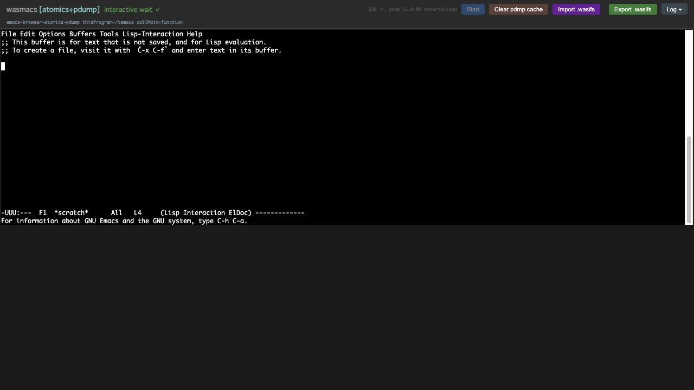
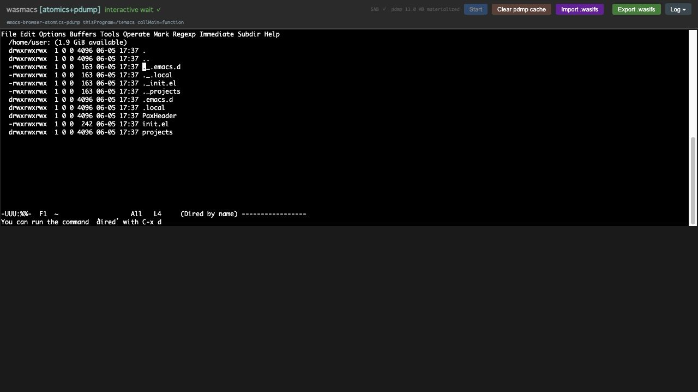
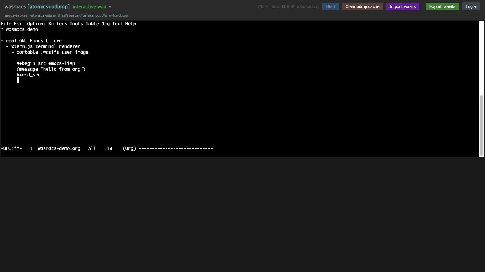

# wasmacs

`wasmacs` は、GNU Emacs をブラウザ上で動かすプロジェクトです。

これは「Emacs 風のエディタ」を作るプロジェクトではありません。GNU Emacs 30.2 の C core と Elisp runtime を中心に置き、表示、入力、永続化、可搬ファイルシステムイメージをブラウザ側で支えることで、本物の Emacs を WebAssembly 上で動かすことを目指しています。

現在の主ルートは、`SharedArrayBuffer` / `Atomics.wait` / pdump / xterm.js を使うブラウザ実行ルートです。`*scratch*`、Dired、Org-mode、`load-file` による Elisp 読み込み、`.wasifs` の import/export に加えて、サブプロセスも動きます。`M-x shell`、eshell、git、grep、Magit、Ediff、Python REPL がブラウザのタブの中で動作します。

## 現在できること

- ブラウザ上で GNU Emacs 30.2 の C core を起動する
- xterm.js 上で Emacs の `--nw` 画面を表示する
- `TERM=xterm-256color` で truecolor、制御キー、カーソル、マウス、bracketed paste、リサイズを扱う
- bundled `bootstrap-emacs.pdmp` を materialize して interactive waitpoint まで到達する
- `user-filesystem.wasifs` を import/export する
- `load-file` によってユーザー側 `.wasifs` 内の Elisp を読み込む
- GitHub Pages 上の静的配信でも起動する
- `url.el` / `package.el` 系の HTTP(S) リクエストを `host.network.fetch` 経由に流す
- package archive と Git remote に、唯一のネットワーク経路である Chrome companion 拡張を通じてアクセスする
- emacsでのヤンクをブラウザ clipboard に流す
- Emacs からサブプロセスを起動する（`call-process`、`make-process`、`shell-command`、`M-x shell`、外部コマンドとパイプを使う eshell）
- POSIX シェル（BusyBox の `ash`）と約150個のコマンド、git 2.52、GNU grep 3.12、GNU diffutils 3.12、CPython 3.14 を、パイプ・シグナル・`fork`・`exec` を備えた本物のプロセスとして動かす
- `M-x grep`、`rgrep`、`lgrep`、xref / project の検索、`vc-git`、Magit（status、stage、Emacs でメッセージを編集する commit、log、diff）を使う

## まだ制限があること

- プロセスは host のものではなく、wasmacs 自身の process service が提供します。動かせるのは同梱したプログラム（BusyBox のコマンド群、git、GNU grep、GNU diffutils、CPython）だけです。[サブプロセス](#サブプロセス-shellgitgrep) を参照してください
- 擬似端末（pty）と socket はありません。`M-x term` / `ansi-term` は動きません（`M-x shell` と eshell は動きます）。Git の `clone` / `fetch` / `push` は Chrome 拡張経由の Smart HTTP(S) とローカルリポジトリに対応します
- スケジューリングは1スレッド上の協調型です。システムコールや定期チェックを行わない長時間の計算では中断が遅れます。CPython のインタープリターには Python のループ用の定期チェックを追加しています
- ネットワークアクセスには Chrome companion 拡張（`extension/`）が必要で、接続先は拡張が許可する host に限られます。拡張がなければ `package-refresh-contents` や `git clone` などのネットワーク機能は失敗します。[ネットワークアクセス](#ネットワークアクセス) を参照してください
- GUI Emacs の native frame を移植しているわけではなく、現状は xterm.js 上の terminal Emacs です
- `docs/` に置く Pages 用 artifact は、GitHub Pages で扱える形に分割・制限しています
- VS Code `.wasifs` extension 用の別ビルドルートを生成できる

## リポジトリ構成

```text
src/wasm/   ブラウザ wasm app のソース
src/assets/ 生成 docs にコピーされるソースアセット
src/build/  docs と artifact 生成用スクリプト
src/c/      Emacs C 側の patch layer
src/runtime/ host/runtime libraries used by tests and tools
src/runtime/process/ process service（kernel、プロセスごとの runtime、userland のファイル配置）
src/userland/ プロセスとして動くプログラム（BusyBox、git、GNU grep）のビルド
tools/      build / validation / probe / inspection tools
extension/  Chrome companion 拡張（唯一のネットワーク経路）
vendor/     pinned upstream GNU Emacs source。read-only
build/      copied Emacs working tree、temporary state、generated artifacts
build/artifacts/ generated wasm / pdmp / wasifs build products
build2/     VS Code 専用 copied Emacs workspace と runtime artifacts
doc/        architecture and planning notes
docs/       GitHub Pages output
vscode/     generated VS Code webview app bundle
logs/       ignored runtime logs。Git には .gitkeep のみ残す
tests/      automated test code
archive/    退役した仕組み（archive/retired/、索引は archive/README.md）と古い出力
```

`vendor/emacs` は pinned upstream GNU Emacs source です。直接編集しません。製品が Emacs に加える変更は `src/c/patches/` の番号付き patch で、copied build tree に適用します（`src/c/README.md` を参照）。

製品ルートは、ページ1つ・worker 1つ・ビルド1つです。`src/wasm/xterm-atomics-pdump.html`、`src/wasm/src/emacs-atomics-pdump-worker.js`、`src/build/build-emacs-browser-atomics-pdump-profile.sh` がそれにあたります。以前の仕組み（command bridge を使う textarea アプリ、Asyncify の command protocol、初期の build spike、self-hosted fetch proxy）は `archive/retired/` に移してあり、`tests/runtime/canonical-route.test.js` が、現役のファイルがそれらに依存しないことを確認します。

## ブラウザアプリ

開発中の主ルートは次です。 `npm run dev` で起動します。

```text
http://127.0.0.1:5173/app/xterm-atomics-pdump.html
```

`make docs` は GitHub Pages 用 bundle を生成します。`docs/index.html` は `/` から canonical app page である `/app/xterm-atomics-pdump.html` へ redirect します。

Pages bundle は次の方針で構成されています。

- `SharedArrayBuffer` のために root の `coi-serviceworker.js` で COOP/COEP 相当の環境を作る
- project pages でも動くように app / artifact URL は relative にする
- Emscripten glue は `temacs.js` として配信し、静的サーバーが JavaScript MIME type を返せるようにする
- 大きな Emscripten preload package は、単一の巨大な `temacs.data` ではなく `docs/artifacts/temacs.data.parts/` 以下の chunk として置く

通常の diagnostic log は静かにしています。詳細ログを見たい場合は次の query を付けます。

```text
?debug-log=1
```

DevTools で viewport をリサイズしながら調査する場合は、起動後の terminal size を安定させるために次も使えます。

```text
?no-live-resize=1
```

## スクリーンショット

### Startup



### Dired



### Org File



## 必要なもの

- Node.js 24 以上
- npm
- Emscripten toolchain
- GNU make

xterm.js は `node_modules` に vendor せず、ブラウザページから jsDelivr CDN 経由で読み込みます。checked-in HTML は `https://cdn.jsdelivr.net/npm/@xterm/xterm@5/...` を直接参照します。

clone 後はまず次を実行します。

```sh
npm ci
```

## よく使うコマンド

```sh
make check-patches
make test
make build
make userland
make test-process
make vscode-build
make docs
make dev
```

`make check-patches` は `src/c/patches/*.patch` が pinned の `vendor/emacs` に適用できることを確認します。製品ビルドは copied tree への適用を自分で行います（`src/build/apply-emacs-patches.sh`）。`vendor/emacs` を直接編集しないでください。

`make build` は Emacs wasm / pdmp / wasifs artifact と process userland を `build/artifacts/` 以下に再生成し、その後 GitHub Pages 用 bundle を `docs/` に反映します。

`make userland` は、プロセスとして動くプログラムだけをビルドします（`build/artifacts/userland/`）。初回は BusyBox、git、GNU grep、GNU diffutils、CPython のリリース tarball を `build/userland/` 以下にダウンロードします。sha256 はビルドスクリプトに固定してあります。

`make test`（`npm test`）は CI が実行するものです。runtime contract のテストに加えて、checked-in の `docs/` bundle を Node 上で起動し、Emacs から `sh`・`git`・`grep` を実行するテストを含みます。`make test-process` は process service の全テスト（kernel のテストと、本物の Emacs が本物のサブプロセスを動かすテスト）を実行します。`npm run browser:smoke:processes` は headless Chrome で実際のページを操作します。

`make dev` は開発サーバーを起動します。開発サーバーでは runtime file を `/artifacts/...` として公開し、Pages と同じ URL contract で worker / smoke URL が動くようにしています。

`make vscode-build` は VS Code `.wasifs` extension 用の別ルートを生成します。VS Code 専用 artifact は `build2/artifacts/` に置かれ、webview app bundle は `vscode/app/` に置かれます。このルートは `docs/app` や `docs/artifacts` を消費・更新しません。

## サブプロセス: shell、git、grep

ブラウザにはプロセスがありません。そこで wasmacs は UNIX 風の小さな kernel を自前で持ちます（`src/runtime/process/wasmacs-kernel.js`）。kernel は Emacs の worker の中で動きます。Emacs がプロセス1で、それ以外のプロセスは、Emscripten と Asyncify でビルドしたプログラムの WebAssembly instance です。プロセスごとに独立したメモリを持ち、ファイルシステムは Emacs と共有します。kernel は `fork`、`exec`、`posix_spawn`、`wait`、パイプ、シグナル、プロセスグループ、タイマーを提供し、どれかのプロセス（または Emacs）がシステムコールをするたびにプロセスを切り替えます。

```text
Emacs (callproc.c, process.c)        emacs_spawn / waitpid / kill / pipe / poll
  -> process kernel                  スケジューラ、パイプ、シグナル、fd table
       -> /bin/sh, /bin/ls, ...      BusyBox（1つの image に約150コマンド）
       -> /bin/git                   git 2.52
       -> /bin/grep                  GNU grep 3.12
       -> /bin/diff, /bin/diff3       GNU diffutils 3.12
       -> /bin/python3, /bin/python  CPython 3.14
```

これで Emacs からできること:

- `M-x shell` と eshell。パイプ、リダイレクト、バックグラウンドジョブ、`C-c C-c` を含みます
- 同期サブプロセスを `C-g` で中断する
- ファイルシステム上のリポジトリに対する git。`vc-git` と Magit が動きます。`/home/user` 以下のリポジトリはページを再読み込みしても残ります（実行ビットと更新時刻を user image と一緒に保存します）
- `M-x grep`、`rgrep`、`lgrep`、`project-find-regexp`、`xref-find-references` を、Emacs の既定値のまま使う
- シェルスクリプト、`find`、`sed`、`awk`、`diff`、`tar`、`gzip` など BusyBox のコマンド

できないこと:

- 擬似端末はありません。プログラムから見えるのはパイプなので、`M-x term` は動かず、全画面を使うプログラムは使えません
- raw socket はありません。Git の clone/fetch/push は Chrome 拡張経由の Smart HTTP(S) に対応します。SSH と `git://` は使えません
- 同梱したもの以外のプログラムは動きません。コンパイラ、パッケージマネージャはありません
- `/home/user` は、変更があるたびに全体を1つの image として保存します。非常に大きなリポジトリでは保存が遅くなります

Magit は同梱していません。`package.el` でインストールするか（下の「ネットワークアクセス」を参照）、pack した `.wasifs` image で持ち込んでください。

### Python REPL

`M-x run-python` で `*Python*` バッファに同梱の CPython を起動します。
`>>>` に式を入力して実行できます。実行中の Python のループは `C-c C-c` で
中断してプロンプトに戻り、`exit()` で終了します。Python ソースのバッファでは
`C-c C-z` で REPL に移動し、`C-c C-c` でバッファを実行できます。
シェルからは `python3 -i`、`python3 script.py`、`python3 -c 'print(1 + 2)'` も使えます。

Python はブラウザ内で動き、Emacs とファイルを共有します。`/home/user` 以下に
保存したファイルは通常の user image に保存されます。Python 本体と標準ライブラリの
ZIP は初回起動時に読み込みます。Chrome 拡張やホスト側の Python は不要です。

単一スレッド・パイプ接続の CPython です。pip、ネイティブ拡張 wheel、Python の
通信、スレッド、subprocess は提供しません。Python のループは定期的に制御を戻して
割り込みを受け付けますが、signal check のない長時間の C 処理は中断が遅れる場合があります。

検証は `npm run test:python` と `npm run browser:smoke:python`。
ビルドの詳細は [src/userland/python/README.md](src/userland/python/README.md) を参照してください。

### Ediff による比較・マージ

`M-x ediff-files` / `M-x ediff-buffers` で2つのファイル・バッファを比較できます。
`M-x ediff-files3` は3方向比較、`M-x ediff-merge-files-with-ancestor` は
共通祖先を使ったマージです。Emacs 標準の画面で `n` / `p` による差分移動、
`q` による終了が使えます。2方向比較・マージの反映は `a` / `b`、
3方向比較では `ab`（AからB）や `ac`（AからC）などパネルに表示される操作を使います。

GNU diffutils 3.12 の `diff` と `diff3` を wasm として同梱しています。
ホスト側へのインストールや通信拡張、Ediff の追加設定は不要です。
シェルも GNU 版を使うよう、BusyBox の `diff` applet は無効にしています。
検証は `npm run test:ediff` と `npm run browser:smoke:ediff` で実行します。

設計は `doc/process-service.md` に書いてあります。

## ネットワークアクセス

wasmacs では、ネットワークアクセスをブラウザ host capability として明示的に扱います。その唯一の経路が `extension/` の Chrome companion 拡張です。ページ自身が remote URL を fetch することはなく、proxy への fallback もありません。拡張がなければ `package-refresh-contents`、`git clone` などのネットワーク機能は、拡張の名前を示すエラーで失敗します。拡張を読み込めないブラウザではネットワークは使えません。

Emacs core に raw socket を渡して package download をさせるのではありません。代わりに、checked-in の `wasmacs-url-fetch` Lisp overlay が `url.el` の HTTP(S) リクエストを `host.network.fetch` に流します。これにより、`package-refresh-contents`、`package-install`、`use-package :ensure` などは request/response service として実行できます。Git の HTTP helper も、再開可能な process import を通じて同じ request/response の境界を使用します。

すべてのリクエストは同じ経路を通ります。

```text
Emacs (url.el / git-remote-http)
  -> Emacs worker の host.network.fetch
  -> page relay（worker は SharedArrayBuffer の result slot で待つ）
  -> content-script bridge（WASMACS_PROXY_* メッセージ）
  -> 拡張の service worker
  -> allowlist に従った fetch
  -> status / フィルタ済み headers / base64 body
```

拡張自身の `fetch` はページの CORS 制約を受けないため、GNU ELPA のような package archive も読めます。ただし到達できるのは、manifest の host permissions と拡張の allowlist の両方に含まれる target だけです。ブラウザ全体の CORS を無効にするものではありません。

### Chrome companion 拡張のインストール

`chrome://extensions` を開き、Developer mode を有効にして Load unpacked から `extension/` を選びます。その後 wasmacs のページを再読み込みしてください。ページは最初のリクエスト時に拡張を検出します。

既定の拡張ポリシーでは、呼び出し元として `http://localhost/*`、`http://127.0.0.1/*` のローカルページと、公開 Pages アプリ `https://modeverv.github.io/wasmacs/*` を許可します。fetch 先として許可するのは GNU ELPA、MELPA、raw GitHub files、GitHub です。private network の target と credential 付きリクエストは既定で拒否します。他の host に接続するには、`extension/manifest.json` の `host_permissions` と、拡張の options ページの allowlist の両方に追加します。

`package-refresh-contents` が GNU ELPA の package menu まで到達することを、次の URL で手動確認済みです。

```text
http://127.0.0.1:5173/app/xterm-atomics-pdump.html?autostart
```

Emacs 側の smoke 式:

```elisp
(progn
  (require 'wasmacs-url-fetch)
  (wasmacs-url-fetch-enable)

  (require 'package)
  (setq package-user-dir "/home/user/.emacs.d/elpa"
        package-check-signature nil
        package-archives '(("gnu" . "https://elpa.gnu.org/packages/")))
  (package-initialize)
  (unless package-archive-contents
    (package-refresh-contents))

  (require 'use-package)
  (setq use-package-always-ensure t)
  (use-package rainbow-mode
    :ensure t
    :demand t))
```

ping テスト、安全な GET テスト、options ページ、audit log については `extension/README.md` を参照してください。

### Git の clone / fetch / push

拡張をインストールしたら、`M-x shell` や eshell で通常の Smart HTTP(S) remote を使います。

```sh
git clone https://github.com/OWNER/REPOSITORY.git
cd REPOSITORY
git fetch origin
git push origin main
```

target には Chrome の host permission と拡張の allowlist エントリの両方が必要です。GitHub は最初から含まれています。private リポジトリや認証付き push では、拡張の options で **Allow credentials** を有効にし、allowlist には HTTPS の host を完全一致で書きます。認証情報は wasmacs の中で Git credentials か URL を限定した `http.extraHeader` として与えます。拡張はホストマシンの認証情報を取り込まず、token も保存しません。`/home/user` に保存した認証情報は可搬 user image の一部になります。認証付きリクエストと POST は redirect を追わないので、正規の remote URL を使ってください。

helper は pin した Git の `remote-curl.c` をそのまま使ってビルドしており、negotiation、pack の検証、ref の更新は Git 自身が行います。protocol v0/v2 に対応します。HTTP body はバッファされ、**リクエスト・レスポンスそれぞれ 25 MiB**、**タイムアウト 30 秒** の上限があります。大きなリポジトリはこの上限を超えることがあります。SSH、`git://`、dumb HTTP/WebDAV、cross-origin の packfile ダウンロードは提供しません。`C-g` やプロセス終了で処理中のリクエストは取り消されます。失敗したリクエストはエラーとして報告され、再送はしません。取り消しや失敗に終わった push もサーバーに届いている可能性があるので、再実行の前に remote を確認してください。

実際の Chrome と拡張による clone / fetch / push の検証は `npm run test:git-http`（使い捨ての HTTPS リポジトリが相手）、wasm の Git transport の検証は `npm run test:git-http:transport` で実行します。どちらもユーザーの remote には push しません。実装の詳細は [Git HTTP adapter](src/userland/git/README.md) を参照してください。

### 廃止: 直接 fetch と self-hosted proxy

以前は、ページからの直接 `fetch` と self-hosted fetch proxy も試していました。`proxy/` のサンプル、開発サーバーの `__wasmacs_network_fetch` route、ページパラメータ `network-proxy` と `network-transport`、Lisp 変数 `wasmacs-url-fetch-proxy-url` がそれにあたります。これらは 2026-11-13 に廃止しました。proxy サンプルとそのテストは `archive/retired/self-hosted-fetch-proxy/` に残してあります。`archive/README.md` を参照してください。

## `.wasifs` イメージ

`.wasifs` は、ブラウザ runtime で使う可搬ファイルシステムイメージです。

現在の spike format は tar-compatible です。そのため、低レベル確認には通常の `tar` が使えます。

```sh
tar tf user-filesystem.wasifs
```

通常の repo 作業では npm script を使います。

```sh
npm run wasifs:list -- user-filesystem.wasifs
npm run wasifs:pack -- ./home-user user-filesystem.wasifs --root home/user
npm run wasifs:unpack -- user-filesystem.wasifs ./out
```

`wasifs:pack` は local directory を指定された image root に pack します。

- writable user image の場合は `--root home/user`
- read-only system image 実験の場合は `--root system`

`wasifs:list` と `wasifs:unpack` は、`PaxHeader`、AppleDouble `._*`、`.DS_Store` などの tar metadata noise を隠します。見える tree は可搬 filesystem contents に寄せています。

### Helmをpack経由でインポートして動作する例


## artifact policy

build output は `build/artifacts/` に生成します。

publishable な `docs/` tree には、checked-in browser bundle と Pages-safe runtime artifacts だけを含めます。`docs/artifacts/` に置けるものは `tools/scripts/validate-git-artifact-policy.sh` で検証します。

古い 512MB pdump restore failure は現在の browser status ではありません。現在の Atomics/pdump xterm route は、bundled pdmp を materialize し、dev server と static Pages bundle の両方で interactive waitpoint に到達することを確認しています。

`make clean` は legacy `dist/` があれば削除し、`build/` と `docs/` を空にします。ただし、`build2/` と `vscode/` は意図的に残します。Pages 用ルートと VS Code 用ルートを独立して検証できるようにするためです。

runtime / validation log は `logs/` に書かれますが、log file は Git ignore されます。reorganization baseline 以前の historical logs は `archive/old-logs/` に置きます。

`build/artifacts/host-abi.wit` は `src/build/generate-host-abi-wit.mjs` から生成される build artifact です。`src/` 以下の source ではありません。検証は `tools/scripts/validate-host-abi.sh` が担当します。

`dist/` は現在の layout には含まれません。

## アーキテクチャ

wasmacs の基本構成は次の 3 つです。

```text
emacs-core.wasm
system-lisp.wasifs
user-filesystem.wasifs
```

`emacs-core.wasm` は GNU Emacs の C core、Elisp interpreter、bytecode runtime、built-in primitives を含みます。

`system-lisp.wasifs` は固定された Emacs release に対応する read-only image です。GNU Emacs の `lisp/`、`.el`、`.elc`、autoload/loaddefs、`etc/` support files を含めます。

`user-filesystem.wasifs` は writable portable image です。`init.el`、ELPA packages、site-lisp、作業ファイル、journal/snapshot metadata などを含めます。

起動時の基本 mount は次の形を想定しています。

```text
/system    read-only
/home/user writable
/tmp       volatile
```

`load-path` は user image を system image より優先します。

```text
/home/user/.emacs.d/lisp
/home/user/.emacs.d/elpa/*/
/system/lisp
```

この設計により、Emacs runtime、標準 Lisp distribution、ユーザー workspace の更新サイクルを分離できます。

詳しい設計変更や runtime ownership boundary を触る前に、以下を読んでください。

```text
ARCHITECTURE.md
PLAN.md
doc/small-os-for-emacs.md
```

## 設計上の原則

- Emacs core が editor semantics を所有する
- Browser UI は表示と入力の host であり、undo、kill-ring、region、minibuffer、file-visiting semantics を偽装しない
- `.wasifs` は可搬 workspace の単位として扱う
- `vendor/emacs` は read-only とする
- process は host ではなく compatibility layer（`src/runtime/process`）の service として提供する。Emacs 自身の process code はそのまま動く。pty と socket は明示的に unavailable boundary のままとする
- product behavior と diagnostic behavior を分ける
- low-level substrate は C/wasm-first とし、JavaScript は browser coordinator / host capability provider / diagnostic harness に留める

## (開発中) VS Code `.wasifs` extension

VS Code `.wasifs` extension は Pages bundle とは別の lane です。

```sh
make vscode-build
```

このコマンドは VS Code 専用 runtime artifacts を `build2/artifacts/` に生成し、webview app bundle を `vscode/app/` に生成します。`docs/app` や `docs/artifacts` は更新しません。

これにより、GitHub Pages 用 browser app と VS Code webview extension 実験を同じ repository 内で共存させつつ、artifact の責務を分離しています。

## 開発メモ

このプロジェクトは、Emacs をブラウザに移植するだけでなく、Emacs が期待する小さな compatibility OS をブラウザ内に与える試みでもあります。

重要なのは、shim を場当たり的に増やすことではなく、Emacs が必要とする lifecycle、memory/root safety、control-flow、blocking input、filesystem/persistence、preloaded state、host capability、browser GUI boundary を、それぞれ責務として整理することです。

そのため、runtime ownership boundary や C/wasm host surface を変更する場合は、単に「動く patch」を入れるのではなく、どの service のどの invariant を満たすのかを明確にしてください。
