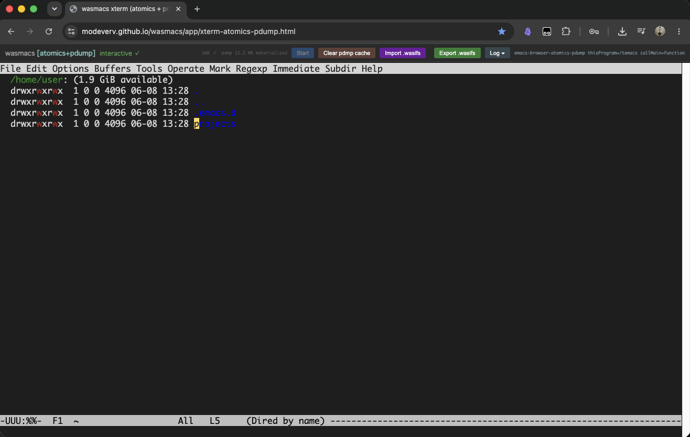

# wasmacs

`wasmacs` is a project for running GNU Emacs in the browser.

This is not a project to build an "Emacs-like editor." Its goal is to run the real Emacs on WebAssembly by keeping the GNU Emacs 30.2 C core and Elisp runtime at the center, while the browser side provides display, input, persistence, and portable filesystem images.

The current main route is the browser runtime built on `SharedArrayBuffer`, `Atomics.wait`, pdump, and xterm.js. It has reached `*scratch*`, Dired, Org mode, Elisp loading through `load-file`, import/export of `.wasifs` images, and subprocesses: `M-x shell`, eshell, `M-x term`, git, grep, Magit, Ediff and the Python REPL run inside the browser tab.

## Current Capabilities

- Boot the GNU Emacs 30.2 C core in the browser
- Display Emacs `--nw` through xterm.js
- Handle truecolor, control keys, cursor movement, mouse input, bracketed paste, and resizing with `TERM=xterm-256color`
- Materialize the bundled `bootstrap-emacs.pdmp` and reach the interactive waitpoint
- Import/export `user-filesystem.wasifs`
- Load Elisp from the user-side `.wasifs` image with `load-file`
- Boot from static hosting on GitHub Pages
- Route `url.el` / `package.el` HTTP(S) requests through `host.network.fetch`
- Reach package archives and Git remotes through the Chrome companion extension, the only network transport
- Copy yanked text to the browser clipboard
- Start subprocesses from Emacs: `call-process`, `make-process`, `shell-command`, `M-x shell`, eshell with external commands and pipelines
- Use `M-x term` / `ansi-term`: a shell on a pseudoterminal, with line editing, `vi`, `less`, `stty` and window resizing
- Run a POSIX shell (BusyBox `ash`) and about 150 command line tools, git 2.52, GNU grep 3.12, GNU diffutils 3.12 and CPython 3.14 as real processes with pipes, signals, `fork` and `exec`
- Use SQLite from Emacs Lisp (`sqlite-open`, `sqlite-execute`, `sqlite-select`): SQLite 3.54 is linked into the runtime
- Use Emacs as a Lisp engine from a web page: send Lisp, get JSON back (the eval service, [doc/eval-service.md](doc/eval-service.md))
- Use `M-x grep`, `rgrep`, `lgrep`, the xref/project search commands, `vc-git`, and Magit (status, staging, commit with the message edited in Emacs, log, diff)

## Current Limitations

- Processes are provided by wasmacs's own process service, not by the host: only the bundled programs (BusyBox tools, git, GNU grep, GNU diffutils, CPython) can run. See [Subprocesses](#subprocesses-shell-git-grep).
- There are no raw sockets and no job control (`C-z`, `fg`, `bg`). Git `clone`, `fetch` and `push` support Smart HTTP(S) through the Chrome companion, as well as local repositories.
- Scheduling is cooperative on one thread. Computation without system calls or explicit polling points delays interruption. CPython's interpreter includes polling points for Python loops.
- Network access requires the Chrome companion extension (`extension/`) and is limited to the hosts it allows. Without it, `package-refresh-contents`, `git clone` and other network features fail. See [Network Access](#network-access).
- There is no GnuTLS and there are no dynamic modules: Lisp has `secure-hash` (SHA-2) and random bytes from the browser, but no HMAC primitive, no cipher and no public-key operation, and Emacs cannot listen on a socket. The bundled Python has no OpenSSL either (`hashlib` without `pbkdf2_hmac` and `scrypt`, no `ssl`). See [doc/eval-service.md](doc/eval-service.md#hashes-random-bytes-sockets).
- This is not a port of native GUI Emacs frames. The current route is terminal Emacs running on xterm.js.
- Pages artifacts under `docs/` are split and constrained so they can be hosted by GitHub Pages.

## Repository Layout

```text
src/wasm/   browser wasm app source
src/assets/ source assets copied into generated docs output
src/build/  docs and artifact generation scripts
src/c/      Emacs C-side patch layer
src/runtime/ host/runtime libraries used by tests and tools
src/runtime/process/ process service: kernel, its boot code (kernel first, then init), per-process runtime, filesystem layout of the userland
src/userland/ builds of the programs that run as processes (BusyBox, git, GNU grep, GNU diffutils, CPython)
tools/      build / validation / probe / inspection tools
extension/  Chrome companion extension: the only network transport
vendor/     pinned upstream GNU Emacs source; read-only
doc/        design documents, indexed in doc/README.md; doc/history/ keeps finished plans
docs/       GitHub Pages output (checked in; generated by `make build`)
tests/runtime/ contract tests run by `npm test` and CI
tests/process/ kernel tests and the Emacs test cases of the process service
archive/    retired mechanisms (archive/retired/), the VS Code extension experiment (archive/extensions/) and old outputs; indexed in archive/README.md
logs/       ignored runtime logs; only .gitkeep is kept in Git

generated, not in Git:
build/      copied Emacs working tree, temporary state, and generated artifacts
build/artifacts/ generated wasm / pdmp / wasifs build products
```

Documents at the top level: `ARCHITECTURE.md` (ownership boundaries), `PLAN.md` (milestones and dated implementation records), `LOG.md` and `MEMORY.md` (working log and project memory of the agent sessions), `AGENTS.md` (instructions for coding agents).

`vendor/emacs` is the pinned upstream GNU Emacs source tree. Do not edit it directly. The product's changes to Emacs are the numbered patches in `src/c/patches/`, applied to a copied build tree (see `src/c/README.md`).

The product route is one page, one worker and one build: `src/wasm/xterm-atomics-pdump.html`, `src/wasm/src/emacs-atomics-pdump-worker.js`, and `src/build/build-emacs-browser-atomics-pdump-profile.sh`. Earlier mechanisms (the textarea app with its command bridge, the Asyncify command protocol, the VS Code `.wasifs` extension experiment and its Asyncify build route, early build spikes, the self-hosted fetch proxies) live under `archive/retired/`; `tests/runtime/canonical-route.test.js` keeps live files from depending on them.

## Browser App

The main development route is available at the following URL after running `npm run dev`.

```text
http://127.0.0.1:5173/app/xterm-atomics-pdump.html
```

`make docs` generates the GitHub Pages bundle. `docs/index.html` redirects `/` to the canonical app page, `/app/xterm-atomics-pdump.html`.

The Pages bundle follows these rules:

- Use the root `coi-serviceworker.js` to provide a COOP/COEP-like environment for `SharedArrayBuffer`.
- Keep app and artifact URLs relative so project pages also work.
- Publish the Emscripten glue as `temacs.js` so static servers return a JavaScript MIME type.
- Store the large Emscripten preload package as chunks under `docs/artifacts/emacs-browser-atomics-pdump/temacs.data.parts/` instead of a single oversized `temacs.data` file.

### Booting without Emacs: `?init=sh`

The kernel boots first and then starts an init program as process 1. That is Emacs by default; the `init` page parameter names another program of the userland, which then runs on the page's terminal without Emacs being downloaded at all:

```text
?init=sh          a POSIX shell (BusyBox ash) as pid 1: a small UNIX terminal
?init=vi          BusyBox vi
?init=python3     the CPython REPL
```

The shell has the bundled tools, git and Python, and `/home/user` is the same persistent image Emacs uses. When init exits the system halts; reload the page to boot again. There is no job control, and Emacs cannot be started from this shell. `npm run browser:smoke:init` checks this route in Chrome.

### Emacs as a Lisp engine: the eval service

The same Emacs build can be used as a library: a page sends Lisp, Emacs evaluates it and returns the value as JSON. There is no terminal and no command loop, and the page needs no cross-origin isolation.

```js
import { createEmacsEvalService } from "./src/emacs-eval-client.js";
const emacs = createEmacsEvalService();
await emacs.eval('(list :sum (+ 1 2) :squares (vconcat (mapcar (lambda (n) (* n n)) [1 2 3])))');
// { sum: 3, squares: [1, 4, 9] }
```

Its first user is [elisp-react](https://github.com/modeverv/elisp-react): React written in Emacs Lisp, where a web page's program is `.el` files, and with a native Emacs as the server a whole application is Emacs Lisp. Try the service itself at `/app/eval-service.html`. It downloads Emacs itself (4.8 MB compressed) and, of Emacs's 146 MB of Lisp, only the files a program reads; a site that carries its own copy of Emacs can carry a 21.6 MB core package instead of the whole. The API, the value conventions, how the files are read and the open issues are in [doc/eval-service.md](doc/eval-service.md). `npm run test:eval-service` checks it in Chrome.

### Embedding the editor

A page of the same origin can show this editor in an iframe: `xterm-atomics-pdump.html?embed=1` hides the header and starts at once, `extra-eval` parameters pass `--eval` forms to Emacs (with `options=parent` the page asks the embedding page for them by message instead, for forms too long for a URL), and the embedding page receives the tar image of `/home/user` in a `wasmacs:user-image` message whenever Emacs has changed a file. The two can also talk: Emacs Lisp sends text with an OSC 7777 terminal sequence, which arrives as a `wasmacs:message`, and the embedding page types into Emacs by posting `wasmacs:input`.

[](https://github.com/modeverv/elisp-studio) [elisp-studio](https://github.com/modeverv/elisp-studio) uses this to run an application next to the Emacs that edits it.

Routine diagnostic logs are quiet by default. Append the following query parameter to enable verbose logs:

```text
?debug-log=1
```

When inspecting the page with DevTools while resizing the viewport, this query parameter keeps the post-boot terminal size stable:

```text
?no-live-resize=1
```

## Screenshots

### Startup


### Dired



### Org File


## Requirements

- Node.js 24 or newer
- npm
- Emscripten toolchain
- GNU make

xterm.js is not vendored through `node_modules`. Browser pages load it from the jsDelivr CDN. The checked-in HTML directly references `https://cdn.jsdelivr.net/npm/@xterm/xterm@5/...`.

After cloning, run:

```sh
npm ci
```

## Common Commands

```sh
make check-patches
make test
make build
make userland
make test-process
make docs
make dev
```

`make check-patches` verifies that `src/c/patches/*.patch` apply to the pinned `vendor/emacs`. The product build applies them to its copied tree itself (`src/build/apply-emacs-patches.sh`). Do not edit `vendor/emacs` directly.

`make build` regenerates the Emacs wasm / pdmp / wasifs artifacts and the process userland under `build/artifacts/`, then refreshes the GitHub Pages bundle under `docs/`.

`make userland` builds only the programs that run as processes (`build/artifacts/userland/`). The first run downloads the BusyBox, git, GNU grep, GNU diffutils and CPython release tarballs under `build/userland/`; their sha256 sums are pinned in the build scripts.

`make test` (`npm test`) is what CI runs: the runtime contract tests, including one that boots the checked-in `docs/` bundle under Node and lets Emacs run `sh`, `git` and `grep`. `make test-process` runs the full process suites (kernel tests, then real Emacs driving real subprocesses); `npm run browser:smoke:processes` and `npm run browser:smoke:term` drive the page in headless Chrome.

`make dev` starts the development server. The development server exposes runtime files at `/artifacts/...`, so workers and smoke URLs use the same URL contract as Pages.

## Subprocesses: shell, git, grep

A browser has no processes, so wasmacs brings a small UNIX-like kernel of its own (`src/runtime/process/wasmacs-kernel.js`). The worker boots it first, and it starts Emacs as its init, process 1 (or another program: see [Booting without Emacs](#booting-without-emacs-initsh)). Every other process is a separate WebAssembly instance of a program built with Emscripten and Asyncify, with its own memory, sharing Emacs's filesystem. The kernel provides `fork`, `exec`, `posix_spawn`, `wait`, pipes, signals, process groups and timers, and switches between processes whenever one of them (or Emacs) makes a system call.

```text
Emacs (callproc.c, process.c)        emacs_spawn / waitpid / kill / pipe / poll
  -> process kernel                  scheduler, pipes, signals, fd tables
       -> /bin/sh, /bin/ls, ...      BusyBox (one image, ~150 commands)
       -> /bin/git                   git 2.52
       -> /bin/grep                  GNU grep 3.12
       -> /bin/diff, /bin/diff3       GNU diffutils 3.12
       -> /bin/python3, /bin/python  CPython 3.14
```

What that gives Emacs:

- `M-x shell` and eshell, including pipelines, redirection, background jobs, `C-c C-c`
- `M-x term` and `ansi-term` (see below)
- `C-g` interrupts a synchronous subprocess
- git on repositories in the filesystem: `vc-git` and Magit work, and a repository under `/home/user` survives a page reload (executable bits and modification times are saved with the user image)
- `M-x grep`, `rgrep`, `lgrep`, `project-find-regexp`, `xref-find-references` with the unmodified Emacs defaults
- shell scripts, `find`, `sed`, `awk`, `diff`, `tar`, `gzip` and the other BusyBox tools

What it does not give:

- no job control: `&`, `wait` and `kill` work, but processes cannot be stopped (`C-z`, `fg`, `bg`)
- no raw sockets: Git HTTP(S) uses the browser host capability; SSH and `git://` are unavailable
- no other programs than the bundled ones; there is no compiler or package manager
- the whole of `/home/user` is saved as one image whenever it changed, so very large repositories make saving slow

Magit is not bundled. Install it with `package.el` (see Network Access below), or bring it in a packed `.wasifs` image.

### Terminal emulator: `M-x term`

`M-x term` (or `ansi-term`) asks for a program, `/bin/sh` by default, and runs
it on a pseudoterminal: the kernel provides `/dev/ptmx`, `/dev/pts/N` and
`/dev/tty`, with a line discipline after Linux's (canonical line editing,
echo, `^C`/`^\` as signals, output processing). Programs see a real terminal:
`isatty`, `tty`, `stty`, BusyBox `ash` line editing and history, `vi`, `less`.
Resizing the window resizes the terminal (`SIGWINCH`).

In char mode `C-c C-c` sends `^C` to the terminal, and `C-c C-j` / `C-c C-k`
switch between line and char mode, as usual in `term`. ESC is a meta prefix
there: ESC and the next key reach the program as one sequence, which BusyBox
`vi` discards as an unknown escape sequence (it does the same on Linux). In
`vi` this leaves commands that need no ESC (`dd`, `x`, `ZZ`, ...); edit files
in Emacs itself.

`M-x shell`, `compile`, `run-python` and Magit keep using pipes
(`process-connection-type` is nil); a program that asks for a pty gets one.

Validation: `npm run test:process` (kernel and Emacs) and `npm run browser:smoke:term`.

### Python REPL

Run `M-x run-python` to open the bundled CPython REPL in `*Python*`.
Enter expressions at `>>>`; use `C-c C-c` to interrupt a running Python loop
and return to the prompt, and `exit()` to finish. From a Python source buffer,
`C-c C-z` switches to the REPL and `C-c C-c` sends the buffer for execution.
The shell also supports `python3 -i`, `python3 script.py` and `python3 -c 'print(1 + 2)'`.

Python executes inside the browser and shares files with Emacs. Files saved
under `/home/user` use the normal user-image persistence. The interpreter and
standard-library ZIP load on the first Python launch; no host Python
installation is required, and the Chrome extension only for network access.

Python starts processes through the same Process Service as Emacs:
`subprocess.run` and `Popen` (captured output, exit status, `input=`,
`check=`, `cwd`, `env`, `shell=True`, timeouts, pipelines), `os.system` and
`os.popen` run the bundled programs. A Python script run in `M-x term` sees a
terminal (`sys.stdin.isatty()` is true); under `M-x shell` or `run-python` it
sees pipes.

```python
import subprocess
print(subprocess.run(["git", "--version"], capture_output=True, text=True))
# CompletedProcess(args=['git', '--version'], returncode=0, stdout='git version 2.52.1\n', stderr='')
```

`urllib.request.urlopen` reaches HTTP(S) URLs through the Chrome companion
extension, like `url.el` (see [Network Access](#network-access)): GET and HEAD
to the hosts the extension allows. Status, headers, `HTTPError` and `URLError`
behave as usual. There are no raw sockets (`socket.socket()` fails with
`EAFNOSUPPORT`), so `http.client`, `requests` and other socket-based clients do
not work.

```python
import json, urllib.request
with urllib.request.urlopen("https://raw.githubusercontent.com/modeverv/wasmacs/master/package.json") as r:
    print(r.status, json.load(r)["name"])
```

This is a single-threaded CPython build. Pip, native extension wheels, sockets,
threads and multiprocessing are not provided. Interpreter polling
lets Python loops yield and receive interrupts; long C operations without a
signal check can still delay interruption.

Validation: `npm run test:python`, `npm run browser:smoke:python` and
`npm run browser:smoke:term`.
Build details: [src/userland/python/README.md](src/userland/python/README.md).

### Comparing and merging with Ediff

`M-x ediff-files` and `M-x ediff-buffers` use the bundled GNU `diff`.
Three-way comparison and common-ancestor merges use the bundled `diff3`:
`M-x ediff-files3` and `M-x ediff-merge-files-with-ancestor`.
Ediff remains Emacs's own comparison UI: use `n` / `p` to move between
changes and `q` to leave the session. In two-way comparison and merge, `a` /
`b` copies a side; in three-way comparison use the panel's commands such as
`ab` (A to B) or `ac` (A to C).

Both commands run inside the browser against the shared filesystem. No
host installation, network extension or special Ediff options are needed.
GNU diffutils supplies normal, context and unified diff formats; the BusyBox
`diff` applet is disabled so shell commands also resolve the GNU implementation.

`npm run test:ediff` exercises real Emacs; `npm run browser:smoke:ediff`
checks the rendered Ediff control panel, navigation, copying and merge.

The design is described in `doc/process-service.md`.

## Network Access

wasmacs treats network access as an explicit browser host capability, and the
Chrome companion extension in `extension/` is its only transport. The page
never fetches remote URLs itself and there is no proxy fallback. Without the
extension, `package-refresh-contents`, `git clone` and other network features
fail with an error that names the extension; browsers that cannot load it have
no network access.

The Emacs core does not receive raw sockets. The checked-in `wasmacs-url-fetch` Lisp overlay routes `url.el` HTTP(S) requests through `host.network.fetch`. This lets `package-refresh-contents`, `package-install`, `use-package :ensure`, and similar features run as request/response services. Git's HTTP helper and Python's `urllib.request` use the same request/response boundary through a restartable process import.

Every request takes the same path:

```text
Emacs (url.el / git-remote-http / Python urllib.request)
  -> host.network.fetch in the Emacs worker
  -> page relay (the worker waits on a SharedArrayBuffer result slot)
  -> content-script bridge (WASMACS_PROXY_* messages)
  -> extension service worker
  -> allowlisted fetch
  -> status / filtered headers / base64 body
```

The extension's own `fetch` is not limited by the page's CORS rules, so package
archives such as GNU ELPA can be read, but it reaches only targets that are in
both the manifest's host permissions and the extension's allowlist. It does not
disable CORS for the rest of the browser.

### Installing the Chrome companion extension

Open `chrome://extensions`, enable Developer mode, choose Load unpacked and
select `extension/`. Then reload the wasmacs page; the page detects the
extension when it makes its first request.

The default extension policy allows local wasmacs pages at `http://localhost/*`
and `http://127.0.0.1/*`, plus the published Pages app at
`https://modeverv.github.io/wasmacs/*`. It allows target fetches for GNU ELPA,
MELPA, raw GitHub files, and GitHub. It rejects private-network targets and
credentialed requests by default. To reach another host, add it to
`host_permissions` in `extension/manifest.json` and to the allowlist on the
extension's options page.

`package-refresh-contents` has been manually verified reaching the GNU ELPA
package menu from:

```text
http://127.0.0.1:5173/app/xterm-atomics-pdump.html?autostart
```

An Emacs-side smoke expression:

```elisp
(progn
  (require 'wasmacs-url-fetch)
  (wasmacs-url-fetch-enable)

  (require 'package)
  (setq package-user-dir "/home/user/.emacs.d/elpa"
        package-check-signature nil
        package-archives '(("gnu" . "https://elpa.gnu.org/packages/")))
  (package-initialize)
  (unless package-archive-contents
    (package-refresh-contents))

  (require 'use-package)
  (setq use-package-always-ensure t)
  (use-package rainbow-mode
    :ensure t
    :demand t))
```

See `extension/README.md` for the ping test, safe GET test, options page, and
audit log notes.

### Git clone, fetch and push

With the extension installed, use ordinary Smart HTTP(S) remotes in
`M-x shell` or eshell:

```sh
git clone https://github.com/OWNER/REPOSITORY.git
cd REPOSITORY
git fetch origin
git push origin main
```

The target must have both Chrome host permission and an extension allowlist
entry; GitHub is already included.
For private repositories and authenticated pushes, enable **Allow credentials**
in the extension's options and use an exact HTTPS host in the allowlist. Supply
authentication using Git credentials or a URL-scoped `http.extraHeader` inside
wasmacs. The extension does not import credentials from the host machine or
store tokens. Credentials saved under `/home/user` are part of the portable
user image. Use the canonical remote URL: authenticated requests and POST do
not follow redirects.

The helper is built from pinned Git's original `remote-curl.c`; Git still owns
negotiation, pack validation and ref updates. It supports protocol v0/v2. HTTP
bodies are buffered and limited to **25 MiB per request and response**, with a
**30 second request timeout**. Large repositories may exceed these limits.
SSH, `git://`, dumb HTTP/WebDAV and cross-origin packfile downloads are not
provided. `C-g`/process termination cancels pending requests; a failed request
is reported and never retried, and a cancelled or failed push can have reached
the server, so inspect the remote before retrying.

Run `npm run test:git-http` for real Chrome/extension clone, fetch and push
against a disposable HTTPS repository, or `npm run test:git-http:transport`
for the wasm Git transport test. Neither test pushes to a user's remote.
Implementation details: [Git HTTP adapter](src/userland/git/README.md).

### Retired: direct fetch and self-hosted proxies

Earlier versions also tried a direct page `fetch` and self-hosted fetch
proxies: the samples in `proxy/`, the development server's
`__wasmacs_network_fetch` route, the `network-proxy` and `network-transport`
page parameters, and the `wasmacs-url-fetch-proxy-url` Lisp variable. They were
retired on 2026-11-13. The proxy samples and their test are kept in
`archive/retired/self-hosted-fetch-proxy/`; see `archive/README.md`.

## `.wasifs` Images

`.wasifs` files are portable filesystem images used by the browser runtime.

The current spike format is tar-compatible. A plain `tar` command can be used for low-level inspection:

```sh
tar tf user-filesystem.wasifs
```

For normal repository work, use the npm scripts:

```sh
npm run wasifs:list -- user-filesystem.wasifs
npm run wasifs:pack -- ./home-user user-filesystem.wasifs --root home/user
npm run wasifs:unpack -- user-filesystem.wasifs ./out
```

`wasifs:pack` packs a local directory under the requested image root.

- Use `--root home/user` for writable user images.
- Use `--root system` for read-only system image experiments.

`wasifs:list` and `wasifs:unpack` hide tar metadata noise such as `PaxHeader`, AppleDouble `._*`, and `.DS_Store`, so the visible tree matches the portable filesystem contents.

### Example: Importing Helm via a Packed Image


## Artifact Policy

Build outputs are generated under `build/artifacts/`.

The publishable `docs/` tree contains only the checked-in browser bundle and Pages-safe runtime artifacts. Files allowed under `docs/artifacts/` are validated by `tools/scripts/validate-git-artifact-policy.sh`.

The old 512MB pdump restore failure is not the current browser status. The current Atomics/pdump xterm route has been verified to materialize the bundled pdmp and reach the interactive waitpoint from both the development server and the static Pages bundle.

`make clean` removes legacy `dist/` if it exists and empties `build/` and `docs/`.

Runtime and validation logs are written under `logs/`, but log files are ignored by Git. Historical logs from before the reorganization baseline are kept under `archive/old-logs/`.

`build/artifacts/host-abi.wit` is generated by `src/build/generate-host-abi-wit.mjs`. It is a build artifact, not source under `src/`. It is validated by `tools/scripts/validate-host-abi.sh`.

`dist/` is not part of the current layout.

## Licence

The code written for wasmacs is under the MIT licence ([LICENSE](LICENSE)), which asks only that its notice be kept. Some of this code runs inside GNU Emacs or is linked into GPL programs; the GPL asks that such code be under a GPL-compatible licence, and MIT is one (the FSF lists it as the Expat licence).

wasmacs also changes, compiles and publishes other people's programs, and those keep their own licences:

- **Changes to them** are under the licence of the program they change: the Emacs patches in `src/c/patches/` are GPL-3.0-or-later, the BusyBox patches and the git adapter GPL-2.0-only, the CPython patches PSF-2.0.
- **The published site** (`docs/artifacts/`) holds GNU Emacs 30.2, GNU grep and GNU diffutils (GPL-3.0-or-later), BusyBox and git (GPL-2.0-only), CPython (PSF-2.0) and SQLite (public domain), compiled with Emscripten (MIT). It is not under MIT.
- **Their source**, the exact archives they were built from, is kept as the files of the release [`sources-2026-11-16`](https://github.com/modeverv/wasmacs/releases/tag/sources-2026-11-16); with the patches and build scripts of this repository it is the complete corresponding source.

[NOTICE.md](NOTICE.md) has the whole table: which file is under which licence, versions, checksums. The texts are in [LICENSES/](LICENSES), and the site publishes all of it under [`licenses/`](https://modeverv.github.io/wasmacs/licenses/NOTICE.txt). A copy of the published files on another site distributes these programs under the same licences and should carry that directory. When the published programs are rebuilt from other sources, the release and `NOTICE.md` change with them.

### SQLite

The published runtime contains, besides GNU Emacs and the programs of the process userland (see `src/userland/*/README.md`), SQLite 3.54.1. SQLite is in the [public domain](https://www.sqlite.org/copyright.html): it may be bundled and redistributed without conditions. Its source is not kept in this repository; `src/build/build-sqlite.sh` downloads the amalgamation from sqlite.org and checks it against the SHA3-256 published there. The database code that uses it, `src/sqlite.c`, is Emacs's own. Database files live in Emacs's in-memory filesystem (under `/home/user` they are part of the persistent user image); there is no write-ahead log and no extension loading.

## Architecture

wasmacs is built around three core pieces:

```text
emacs-core.wasm
system-lisp.wasifs
user-filesystem.wasifs
```

`emacs-core.wasm` contains the GNU Emacs C core, Elisp interpreter, bytecode runtime, and built-in primitives.

`system-lisp.wasifs` is a read-only image tied to a fixed Emacs release. It contains GNU Emacs `lisp/`, `.el` files, `.elc` files, autoload/loaddefs artifacts, and `etc/` support files.

`user-filesystem.wasifs` is a writable portable image. It contains `init.el`, ELPA packages, site-lisp, working files, and journal/snapshot metadata.

The intended mount layout at startup is:

```text
/system    read-only
/home/user writable
/tmp       volatile
```

`load-path` gives the user image priority over the system image:

```text
/home/user/.emacs.d/lisp
/home/user/.emacs.d/elpa/*/
/system/lisp
```

This design separates the update cycles of the Emacs runtime, the standard Lisp distribution, and the user's workspace.

Before changing runtime ownership boundaries or C/wasm host surfaces, read:

```text
ARCHITECTURE.md
PLAN.md
doc/small-os-for-emacs.md
doc/process-service.md
```

`doc/README.md` lists all design documents.

## Design Principles

- The Emacs core owns editor semantics.
- The browser UI is a display/input host; it must not fake undo, kill-ring, region, minibuffer, or file-visiting semantics.
- `.wasifs` is the unit of portable workspaces.
- `vendor/emacs` is read-only.
- Processes are a service of the compatibility layer (`src/runtime/process`), not of the host: Emacs's own process code runs unchanged against it. Pseudoterminals are part of that layer; sockets stay an explicit unavailable boundary.
- Product behavior and diagnostic behavior are kept separate.
- The low-level substrate is C/wasm-first. JavaScript remains the browser coordinator, host capability provider, and diagnostic harness.

## Development Notes

This project is not only a browser port of Emacs. It is also an attempt to provide, inside the browser, the small compatibility OS that Emacs expects.

The important part is not to accumulate ad-hoc shims, but to organize the lifecycle, memory/root safety, control flow, blocking input, filesystem/persistence, preloaded state, host capabilities, and browser GUI boundary that Emacs requires.

When changing runtime ownership boundaries or C/wasm host surfaces, do not just add a patch that happens to work. Make clear which service and which invariant the change satisfies.
